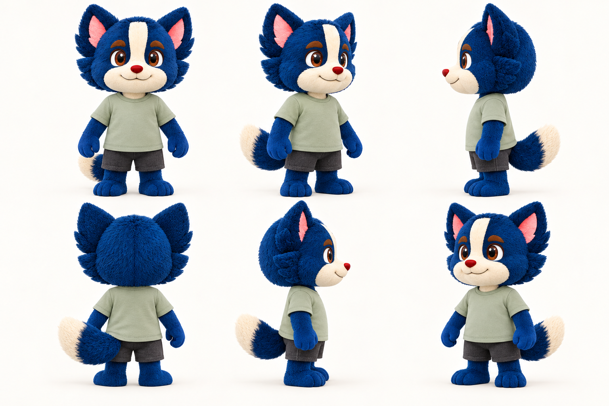
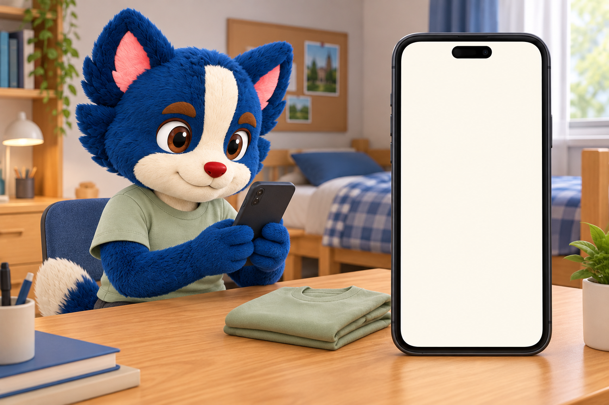
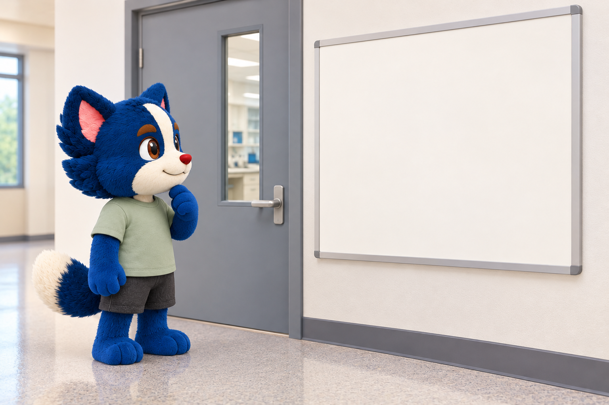
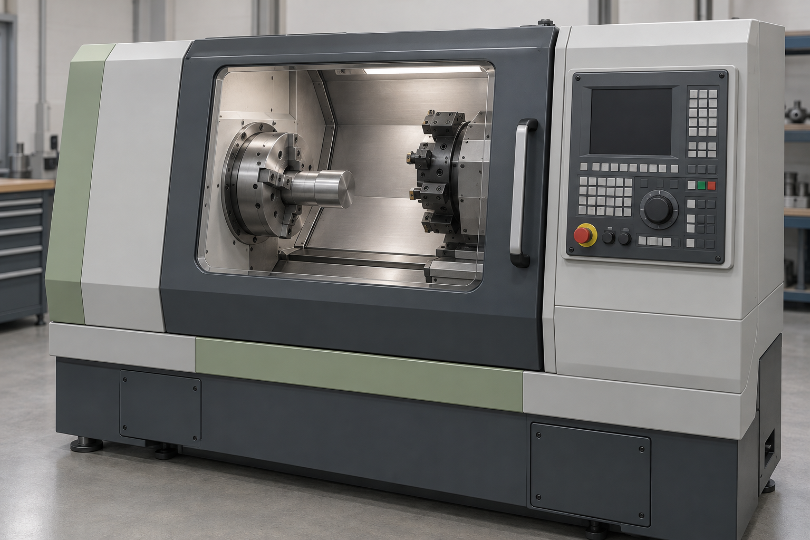

# 真实题库生图试做（2026-10-12）

研究草稿，未发布、未写入演示数据库。完整提示词见 generation.json。底层模型、计费、请求ID未由工具暴露。观察者为本轮助手，依据实际返回图像；未实施独立盲审、专业审核或稳定性对照实验。

## 角色参考

原 character-atlas.png 已有两种角色各三个视角。本轮只选择蓝色犬，生成六方向基础角色，去掉固定实验装备，采用便装。这是新候选设定，不是用户已确认的最终角色。视角仍需核对尾巴、比例、耳朵和花纹一致性，不能当作精确3D模型。后续建议按身份、任务服装/PPE、姿势、表情分别维护，选定后再补手部/面部特写和单独视角文件。

## 1. 可见动作：CPU2025:434

原题主题：实验进行中戴防护手套接电话，原题型判断。实际可见手套与听筒接触，手套有独立材质和袖口。仅凭图不能知道手套使用历史或实验是否正在进行，应由题干明示。表情略有微笑，未完全达到中性表情要求。状态：研究素材候选，未审核发布。

## 2. 空间关系：TSU200:17

原题主题：电源插座附近不应堆放易燃物等杂物，原题型判断。位置关系清楚，无事故效果。首图生成美式插座；v2局部编辑为国内常见两孔/三孔外形，仍未作为标准器材图审核。图像不提供安全距离或负荷依据。编辑记录见 socket-edit.json。

## 3. 信息辨识：CPU2025:207

原题主题：网购商家要求个人银行账户转账并给九折优惠，买家以为被骗后可向网店索赔，原题型判断。吉祥物已换便装，无实验装备。模型主动增加了右侧放大手机，可用于程序排版，但并非写实同一手机画面。空白屏幕目前没有关键证据，不能作为完整题面；后续必须程序添加忠于原题的商家话术和买家假设。状态：辅助底图。

## 4. 隐藏资格：TSU200:37

原题主题：入室前接受安全教育、培训并通过考核，原题型判断。便装角色、门、记录板关系清楚。空白记录板不能证明培训完成或未完成；后续展示的任何状态必须标为有依据的条件或明确改编条件。状态：辅助底图，需信息层。

## 5. 专业设备与多选检查：QCU-M:86

原题为多选，涉及卡盘夹持、防护门、遗留工具三项独立核查，不是排序题。图像为无指定型号的通用封闭数控车床，罩门和工件可见，未见遗留扳手。不能凭图验证夹紧程度、断电或停机；结构及装备真实性需专业核对。不能以这张单状态图代替完整多选选项。状态：专业待核验，不发布。

## 本轮结论

动作/空间题可由图片承担较多证据；消息/资格题依赖程序信息层；专业设备题依赖规范素材和专业核验。多视图有利于明确身份，但这一轮没有对照实验，不能量化稳定性提升。三幅人物图仍有脸部、表情、手部和比例差异。若需要镜头间精确一致，需真正3D建模、材质和绑定后渲染；二维设定图不等于该能力。
